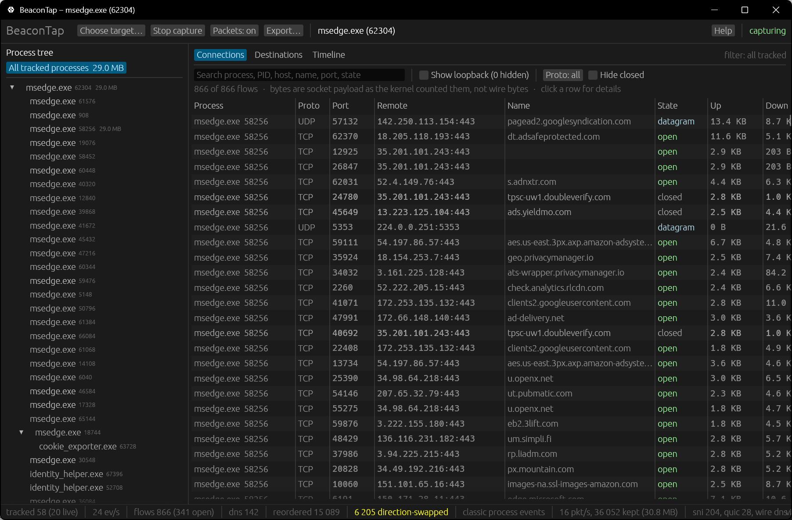

# BeaconTap

See what a program talks to on the network, and nothing else.

BeaconTap is a network monitor for Windows that watches one process tree instead of the whole machine. Pick a running program, or launch one from inside BeaconTap, and it follows that program and every child it spawns: which hosts they connect to, over what, how much data, and when.

I wrote it because Wireshark shows you everything on the wire and makes you work out which process sent it, and Resource Monitor tells you the process but not much else. I wanted both at once.



It's a single native exe written in Rust. No installer, no telemetry, and it never sends anything over the network itself. MIT licensed. Made by [RAZKOM](https://razkom.com).

## What it does

The left pane is the live process tree, built from kernel events, so short-lived helpers show up too, command lines included. The right side has three tabs:

- **Connections**: every TCP and UDP flow from the tree, with the remote host, state, bytes each way, and first/last seen. Click a row for the full details.
- **Destinations**: the same flows grouped by site, optionally rolled up by domain, so you can see at a glance that a "simple" app talks to eleven different companies.
- **Timeline**: bytes per second for the whole tree and each process.

Host names come from the Windows DNS client by default. Turn on the packet layer (one button, off by default) and BeaconTap also reads server names out of TLS and QUIC handshakes, which covers browsers and anything else with its own resolver. Connections to DNS-over-HTTPS resolvers are tagged, so you know why some names are missing.

**Launch & watch** starts the program suspended, starts tracking it, then resumes it, so you don't miss its very first connection. It runs with your normal user token, not BeaconTap's elevated one.

Everything can be exported: connections and destinations as CSV, the whole session as JSON, and the captured packets as pcapng. Each packet in the pcapng has a comment with the owning PID, process name and server name, so you can open it in Wireshark and still know where each frame came from.

Press F1 in the app for a guide to every part of the window. Everything also has a tooltip.

## Quick start

1. Run `beacontap.exe` as administrator. If you forget, it tells you and offers to relaunch itself.
2. Click **Choose target…** and either pick a running process or use **Launch & watch** on an exe.
3. Use the program and watch the tree and the Connections tab fill in.
4. Optional: click **Packets: off** to turn the packet layer on for better names and a pcapng.
5. **Export…** when you're done.

Why admin? The process and network events come from Event Tracing for Windows, and Windows only gives those to administrators. The process list works without it, but capturing doesn't.

## Building

You need Rust 1.95+ and Windows 10 1809+ (x64).

```
cargo build --release
target\release\beacontap.exe
```

`cargo test` runs the unit tests. They replay recorded events, so they don't need admin or a live capture.

## Command line

```
beacontap                       open the picker
beacontap --attach <pid>        watch a running process
beacontap --launch <exe> [--args "<args>"]
beacontap --packets             with either of the above: packet layer on from the start
beacontap --follow-name         also follow new processes named like a tracked one
beacontap --headless            no window; see below
beacontap --spike [seconds]     headless ETW checks, from an administrator prompt
beacontap --log                 verbose logging to stderr
```

`--follow-name` is for programs whose helpers are started by a service or broker rather than by the program itself, so they'd never show up as children.

### Headless

For scripts, from an administrator prompt:

```
beacontap --headless --packets --launch "C:\path\to\program.exe" --out C:\captures
beacontap --headless --attach 1234 --duration 60 --out C:\captures
```

No window opens. It captures until the target's process tree exits (or `--duration` runs out; `--attach` needs one, since a running program may never exit), then writes the JSON, both CSVs and the pcapng to `--out` as `beacontap-<target>-<stamp>.*`. The file paths go to stdout and everything else to stderr.

Exit codes: 0 ok, 2 bad arguments, 3 not admin, 4 capture failed, 5 couldn't write, 6 target not found or didn't start.

## Exports

- **Connections CSV**: one row per flow, including loopback (with a `loopback` column), with process, addresses and ports, name and where it came from, state, socket bytes, wire bytes and packet counts (zero without the packet layer), and timestamps in ISO 8601 UTC.
- **Destinations CSV**: one row per name or address, with the processes and addresses behind it separated by `;`.
- **Session JSON**: metadata, counters, every process with its command line, every flow and every destination.
- **pcapng**: the frames that matched a tracked flow, keeping the newest 64 MB, with one interface per adapter and a comment on each packet.

Settings live in `beacontap-settings.json` next to the exe if that folder is writable, otherwise in `%APPDATA%\RAZKOM\BeaconTap`.

## Limitations

Some of these are Windows, some are me not having got to them yet.

- Byte counts are what the socket layer moved, not what went on the wire, so they won't match Task Manager. Turn on the packet layer if you want wire bytes.
- Only TCP and UDP through the normal Windows socket stack. ICMP (`ping`), raw sockets, WSL2 and Hyper-V guests are invisible.
- Anything a program starts through a UAC prompt gets the AppInfo service as its parent, so it drops out of the tree. Same for UWP apps launched through a broker.
- A connection that never completes (nothing listening, port closed) doesn't show up. Windows only reports a connect once it's established.
- Windows loopback traffic isn't on any adapter, so loopback flows never get wire bytes or packets.
- The packet layer can't read protected Wi-Fi frames, and a QUIC connection that started before you turned the packet layer on stays unnamed.
- No HTTPS decryption and no blocking yet. [docs/DESIGN.md](docs/DESIGN.md) covers how they'd fit.
- If BeaconTap crashes, its ETW sessions can outlive it. The next launch cleans them up, or you can run `logman stop BeaconTap-Kernel -ets` (plus `BeaconTap-Control` and `BeaconTap-Packets`) yourself.

## Design

[docs/DESIGN.md](docs/DESIGN.md) explains how it works: which event sources it uses and why, how it handles PID reuse, and the threading model.

## License

MIT, see [LICENSE](LICENSE).
